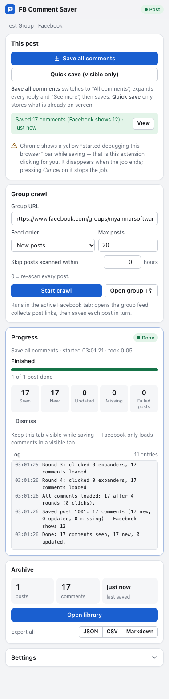
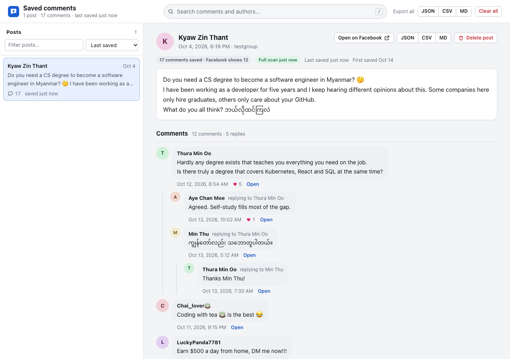

# FB Group Comment Saver

A Chrome extension that saves the comments and replies on Facebook group posts into a local
archive on your computer. It was built for
[Myanmar Software Engineers](https://www.facebook.com/groups/myanmarsoftwareengineers) (the default
group), but works with any Facebook group you can open.

Facebook only shows part of a post's comments at first. To save *all* of them, the extension uses
[Playwright](https://playwright.dev) running inside the extension
([playwright-crx](https://github.com/ruifigueira/playwright-crx)) to do what you would do by hand:
switch the comment filter to **All comments**, scroll, and click **View more comments**,
**View N replies** and **See more** until everything is loaded. It then reads the comments from
the page and stores them, with their reply threads, in your browser.

It never posts, reacts, replies or types anything on Facebook. The only things it clicks are the
comment sort button, the "All comments" menu item, the "View more / View replies" buttons and
"See more".

| Side panel | Library |
|---|---|
|  |  |

<sub>Screenshots use the synthetic test fixtures; all names are fictional.</sub>

## How to use

### 1. Install (one time, about 5 minutes)

You need **Google Chrome 118+**, **Node.js 22+** and **git**.

```bash
git clone https://github.com/channyeintun/fb-group-comment-saver.git
```

```bash
cd fb-group-comment-saver
```

```bash
npm install
```

```bash
npm run build
```

This creates a `dist/` folder. Then load it into Chrome:

1. Open `chrome://extensions` in Chrome.
2. Turn on **Developer mode** (switch in the top-right corner).
3. Click **Load unpacked** and choose the `dist/` folder inside `fb-group-comment-saver`.
4. Click the puzzle-piece icon in the toolbar and **pin** "FB Group Comment Saver".

Make sure you are logged in to Facebook in this Chrome profile (and are a member of the group if it
is private).

### 2. Save every comment on one post

1. Open the group, e.g. <https://www.facebook.com/groups/myanmarsoftwareengineers>.
2. Open a post: click its time stamp (for example "5h" or "4 October at 18:19"). The address bar
   changes to `.../groups/<group>/posts/<id>/` and the post opens as a pop-up. That is fine.
3. Click the extension's toolbar icon. The **side panel** opens on the right; its header chip says
   **Post**.
4. Click **Save all comments**.
5. Watch the **Progress** card. Chrome shows a yellow *"started debugging this browser"* bar while it
   works. That is the extension clicking for you. **Keep the tab visible** until the status says
   **Done** (usually 10–60 seconds per post).

The green line under the buttons then reads e.g. *Saved 19 of 20 comments*. Facebook's count can
include deleted or hidden comments, so "19 of 20" is normal.

### 3. Save many posts at once (group crawl)

1. With any Facebook tab active, open the **Group crawl** card in the side panel.
2. Check **Group URL** (it defaults to Myanmar Software Engineers), choose **Feed order**
   (**New posts** for the latest posts, **New activity** to catch new comments on older posts), and
   set **Max posts** (start small, e.g. 10).
3. Optional: set **Skip posts scanned within N hours** to skip posts you saved recently.
4. Click **Start crawl**. The extension opens the group feed, collects post links, then opens and
   saves each post in turn. Click **Stop** at any time; posts already saved stay saved.

### 4. Quick snapshot without automation

**Quick save (visible only)** stores just what is already on screen (an open post, or the comment
previews in the group feed). It clicks nothing, so no yellow bar appears.

### 5. Read, search and export

- Click **Open library** to browse saved posts and their threaded comments, search all comments by
  text or author, and see edited or deleted comments.
- Click **JSON**, **CSV** or **Markdown** (side panel or library) to download everything, or use the
  buttons on a post to export just that post. CSV opens correctly in Excel, including Myanmar text.

### 6. Updating the extension

```bash
git pull
```

```bash
npm install
```

```bash
npm run build
```

Then click the reload icon on the extension's card in `chrome://extensions`. Your saved comments
are kept. Removing the extension deletes them, so export first.

### Troubleshooting

| Problem | What to do |
|---|---|
| **Save all comments** is greyed out | The active tab must be a post page (`/groups/<group>/posts/<id>/`). Click the post's time stamp to open it. |
| It stops expanding or finds 0 comments | Keep the tab in front and the window not minimized. Facebook only loads comments in a visible tab. |
| "Lost the connection to the tab" | You clicked **Cancel** on the yellow bar or closed the tab. Start again. |
| "Temporarily blocked" / "going too fast" | Facebook rate-limited you. Wait, then raise **Delay between clicks** in Settings and crawl fewer posts. |
| Facebook is not in English | Switch Facebook to English, or adapt the button patterns in **Settings → Advanced** (see below). |
| A crawl logs "collected 0 post links" (or "No post ids found in the feed") | Facebook serves different page layouts to different accounts. Click **Copy diagnostics** (in the Progress card, or **Settings → Troubleshooting**) with the group feed open, and paste the report into your bug report. It holds no names, text or ids. |
| Something else looks wrong on your account only | Open the page in question, click **Settings → Troubleshooting → Copy diagnostics**, and send the report. |
| Using `m.facebook.com` | Not supported. Use `www.facebook.com` or `web.facebook.com`. |

## Features in detail

Click the toolbar icon to open the **side panel**. Each Chrome window has its own side panel, and it
always works on the active tab of **its own window**. The chip in its header tells you what kind of
page that tab is: Post, Group feed, Facebook (another page), Not Facebook, or Mobile site
(unsupported).

### Save all comments (one post)

1. Open a post in the group, for example by clicking its timestamp so the URL looks like
   `https://www.facebook.com/groups/<group>/posts/<id>/`. The post opens as a pop-up over the
   feed. That's fine.
2. In the side panel, under **This post**, click **Save all comments**.

The extension switches the comments to **All comments**, scrolls the post, and keeps expanding
"View more comments", "View N replies" and "See more" until nothing is left. Expansion is capped by
the *max expand rounds* and *per-post timeout* settings. Then it saves everything. If the post was
fully expanded, the save counts as a **full scan**. Comments saved earlier that are no longer on
the post are then marked *not found in last full scan*. They are never deleted. As a safety net, a
scan that would suddenly mark more than a quarter of a post's saved comments (and at least 3) as
not found is saved as a partial scan instead, with a warning in the log.

### Quick save (visible only)

**Quick save (visible only)** saves only what is already on screen. It works on any Facebook tab:
an open post, or the comment previews in a group feed. It doesn't click or scroll anything and
doesn't use the debugger, so no yellow bar appears. Use it for a quick snapshot. Use **Save all
comments** for a complete copy.

### Group crawl

The **Group crawl** card saves many posts in one run:

- **Group URL**: defaults to `https://www.facebook.com/groups/myanmarsoftwareengineers`.
- **Feed order**: **New posts**, **New activity**, **Most relevant** or **Facebook default**.
  The choice is passed to Facebook as `?sorting_setting=`.
- **Max posts**: how many posts to collect from the feed (1–500, default 20).
- **Skip posts scanned within N hours**: skips posts that had a full scan recently (0 = never skip).

Click **Start crawl** with any `www.facebook.com` / `web.facebook.com` tab active. **Open group**
opens the group in the active Facebook tab, or in a new tab if the active tab isn't Facebook or a
job is using it. The crawl:

1. Opens the group feed with the chosen sort, unless the tab already shows exactly that feed in that
   order (another group page such as Members, or another sort, is not enough).
2. Scrolls the feed and collects post links until it has *max posts* or the feed stops growing.
   The post id comes from the post's timestamp link, or, when Facebook hasn't filled that link in,
   from Facebook's own page data, other links of the post, its comments, or by hovering the link
   (each post is hovered at most once, so a post that nothing names cannot hold up the scroll).
   The log shows a one-line summary of where the ids came from.
3. Opens each post and does the same as **Save all comments**.
4. Goes back to the group feed when finished. You can turn this off in Settings.

If a single post fails, the error is logged and the crawl moves on. If the post closes or the tab
navigates away while it is being expanded (for example you click the post's **Close** button),
nothing is saved for that post: the extension never saves whatever page is behind it instead. The
crawl stops right away if Facebook shows a login page or a "temporarily blocked / try again later"
message. Actions are paced: a base delay plus random jitter between clicks.

### Progress, stopping, and the yellow bar

The **Progress** card shows the job's status, its current step, a progress bar, counters (comments
seen, new, updated, missing, failed posts) and a log. Click **Stop** to end a job early. Posts that
were already saved stay saved.

While **Save all comments** or **Group crawl** runs, Chrome shows a yellow bar:
*"FB Group Comment Saver" started debugging this browser*. This is expected. Playwright drives the
tab through Chrome's debugger API (`chrome.debugger`). The bar goes away when the job ends. If you
click **Cancel** on the bar, the debugger detaches and the job stops.

**Keep the tab visible while saving.** Facebook only loads comments in a visible tab. Don't minimize
the window or switch to another tab in that window while a job runs. You can use a different
window.

## Library and exports

The **Archive** card in the side panel shows totals (posts, comments, last saved). It has
**Open library** and **Export all** buttons for JSON, CSV and Markdown.

The **library** page lets you:

- browse saved posts, with saved and expected comment counts, and a badge when the last scan wasn't
  complete
- read the comment threads, with replies indented, author profile links, dates, reaction counts,
  attachments and a link to each comment on Facebook (like Facebook, at most two levels of
  indentation: longer back-and-forth reply chains are listed under the second level, each with
  "replying to …")
- see the earlier versions of comments that were edited between saves
- see comments marked *not found in last full scan*
- search all comments by text or author, and filter the post list
- export a single post or everything, delete a post, or clear the whole archive

Export formats (file names look like `fb-comments-all-20261014-0930.json`):

| Format   | Contents |
|----------|----------|
| JSON     | Every field, with each post's comments nested in order (`format: "fb-comment-saver/v1"`). Best for backups and scripts. |
| CSV      | One row per comment, with the post's details repeated on each row. UTF-8 **with BOM**, so Excel shows Myanmar (and other non-Latin) text correctly. Text cells that start with `=`, `+`, `-` or `@` get a leading `'` so spreadsheets show them as text instead of running them as formulas. Facebook ids have 16–17 digits, more than Excel keeps for a number: when opening the file in Excel or Sheets, import the id columns (`post_id`, `comment_id`, `parent_id`, `thread_id`, `author_id`) as **Text**. |
| Markdown | Readable threads: each post followed by nested comment bullets. |

### Copy diagnostics

Facebook doesn't show every account the same page: it tests different layouts on different users.
If the extension works for a friend but not for you, **Copy diagnostics** helps find out why. It
is in **Settings → Troubleshooting**, and in the Progress card after a job that saved nothing or
failed. It copies a report to the clipboard (or shows it in a text box if copying isn't allowed):

- the extension version, browser and language;
- how the active Facebook page is built: which elements and attributes exist, how many comments
  have links, the *shape* of links (`/groups/{g}/posts/{n}/`), and the *shape* of button text
  (`len14:digit+alpha+space`);
- the last job's counters and its last 40 log lines.

It contains **no names, no post or comment text, no ids (long numbers become `{n}`, `pfbid…` post
ids become `{pfbid}`) and no full URLs**. Read it before you send it if you like: it's plain JSON.

## Your data stays local

Everything is stored in the extension's own IndexedDB in your Chrome profile. The extension makes
no network requests of its own and has no analytics. Saving a post again merges into what is
already stored: the first-saved time is kept, edited comment text is kept as history, and new
comments are added.

Removing the extension deletes its stored data, so export first if you want to keep it. The
archive contains other people's names and words. Store and share the exports with care.

## Settings

Expand **Settings** in the side panel. Changes save automatically. **Reset to defaults**
restores the options in the Settings section; the Group crawl fields (group URL, feed order, max
posts, skip hours) are kept.

| Setting | Default | Meaning |
|---------|---------|---------|
| Switch to "All comments" | on | Change the comment sort from "Most relevant" so comments Facebook filters out are included |
| Expand replies | on | Click "View N replies" (off = top-level comments only) |
| Expand "See more" | on | Expand truncated post and comment text |
| Delay between clicks | 700 ms | Base pause between actions, plus 0–50% random jitter (100–10000) |
| Max expand rounds per post | 40 | Scroll and expand rounds per post (1–200) |
| Time limit per post | 240 s | Time limit for expanding one post (30–1800) |
| Return to the group after a crawl | on | Navigate back to the feed when a crawl ends |
| Advanced: button text patterns | English | Regular expressions that recognise Facebook's buttons (see below) |

**Patterns for non-English Facebook.** Buttons are found by their text. Four case-insensitive
regular expressions are matched against the button text: "View more / View replies" buttons
("View more comments", "View 3 replies", …), "See more" buttons, the comment sort button
("Most relevant", …) and the "All comments" menu item. The defaults match English. If your Facebook is in another language, either switch Facebook
to English or add your language's wording to these patterns, for example
`^see more$|^<your text>$`. An invalid pattern, or one so broad it would match Like/Reply/Hide…,
is flagged when you leave the field and is not saved; the last saved pattern stays in use. Comments are found by their page structure, not their text, so the language only
affects which buttons get clicked and how dates are read.

## Limitations

- **English UI by default.** Other languages need pattern changes (see above). Dates are parsed
  from English text; when parsing fails, the original date text is still saved.
- **`m.facebook.com` (mobile site) is not supported.** Use `www.facebook.com` or
  `web.facebook.com`.
- **Facebook changes its page often.** If saving suddenly finds nothing or stops expanding,
  Facebook's page has probably changed and the patterns or the extension need updating.
- **Image links expire.** Attachment images point to Facebook's CDN (`fbcdn.net`). Those URLs
  stop working after a while, so old thumbnails in the library may not load.
- **Counts may not match.** Facebook's comment count can include deleted or hidden comments that
  can't be loaded. The library shows both the saved and the expected count.
- The tab must stay visible during a job, and only one job can run at a time.

## How it works

```
Side panel (sidepanel.html)
   │  START_JOB / STOP_JOB / GET_JOB messages
   ▼
Service worker: job runner ──── job state ──► chrome.storage.session ──► side panel progress
   │
   ├─ quick:  chrome.scripting.executeScript(extractRaw, MAIN world) ─┐
   │                                                                  │
   └─ post / crawl: playwright-crx attaches to the tab (chrome.debugger)
        Page: sort → All comments, scroll, click expanders and "See more"
        page.evaluate(extractRaw / collectFeedPosts / probePage) ─────┤
                                                                      ▼
                                normalize (ids, threads, depth, dates)
                                                                      ▼
                          IndexedDB (posts, comments) ──► library page and exports
```

- **Page functions** (`src/page/`) run inside the Facebook tab. They read the page and never change
  its content (the feed scan only marks the links it hovers with `data-fbcs-*` attributes). Comments
  are `[role="article"]` elements with an `aria-label`; a post is an article without one, or one
  that has a post's parts (body, Like/Comment buttons), since some accounts get posts with an
  `aria-label` too. Replies are flat in the page rather than nested, so reply depth comes from their
  indentation. Comment and reply IDs come from each comment's timestamp link (`comment_id` /
  `reply_comment_id`) — never from a link pasted in the comment's text, and never from a link that
  Facebook hasn't filled in yet (`href="#"`, which points at the page itself). When Facebook leaves
  those links empty, the IDs are read from Facebook's own page data (React props on the page
  elements, readable only from the page's "MAIN world", which is why quick save and the driver run
  there); a link that names another comment than that data is ignored.
- **The Playwright driver** (`src/background/pw-driver.js`) performs the clicks and scrolling with
  real input events. It retries clicks that something else covers, such as the Messenger chat
  pop-up.
- **Normalization** (`src/lib/normalize.js`) turns raw page data into post and comment records with
  stable IDs, thread and parent links, depth, parsed dates and reaction counts.
- **Storage** (`src/lib/db.js`) merges each save into IndexedDB. A full scan marks comments that
  have disappeared instead of deleting them.

## Development

```
npm run build         # one-off build into dist/
npm run watch         # rebuild on change, then reload the extension in chrome://extensions
npm test              # unit tests (Node's built-in test runner)
npm run test:browser  # page scripts and the Playwright driver against synthetic Facebook fixtures in headless Chromium
npm run test:e2e      # builds, then loads dist/ into Chromium and runs the extension on fixture pages
npm run test:all      # all of the above
```

Browser and end-to-end tests use Playwright's Chromium. If it isn't installed yet, run
`npx playwright install chromium`.

Project layout:

```
build.mjs              esbuild bundling, static copy, manifest version, generated icons
src/manifest.json      extension manifest (version filled in from package.json at build)
src/background/        service worker, job runner, Playwright driver
src/page/              self-contained functions that run in the Facebook tab (extract, feed, probe, diagnose)
src/lib/               settings, URL/date parsing, normalization, IndexedDB, exports, diagnostics masking
src/ui/                side panel and library pages
tests/                 unit, browser (fixtures) and e2e tests
dist/                  build output: load this folder in Chrome
```

Page functions are passed to the tab as source text (`fn.toString()`), so each must be fully
self-contained, and the build never minifies.
